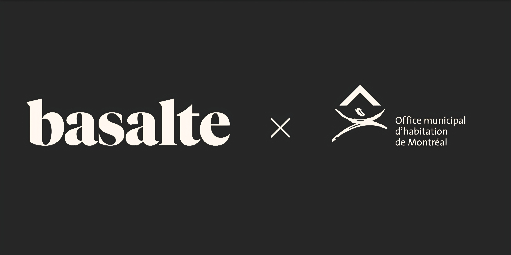

# Analyse du domaine — Kenneth Fadonougbo

## Découverte de soi

- Mes forces : La musique, le dessin, la réalisation de coiffures africaines et la danse.
    - Exemple : J’ai animé mon bal des finissants au secondaire en chantant.
- Mes faiblesses ou points à améliorer : La procrastination
    - Exemple : Je remets toujours la plupart de mes travaux à la veille de leur date de remise.
- Seul(e) ou en équipe : Je préfère travailler en équipe.
    - Pourquoi et exemple : Apprendre plus rapidement grâce à l'expertise de mes coéquipiers, qui possèdent parfois davantage de connaissances que moi dans le domaine du développement Web.
- Plutôt technique ou créatif : Je dirais que je suis une personne davantage portée sur la créativité que sur les aspects techniques.

## Exploration des domaines

| Domaine | Intérêt | Pourquoi |
|---|---|---|
| Graphisme | fort | J'aime le dessin et la création visuelle. |
| Vidéo et animation 2D | faible | Je préfère les images qui offrent davantage de profondeur.|
| 3D | fort | J'aime les images qui offrent davantage de profondeur.|
| Web | moyen | J'aimerais créer des sites Web, mais ce n'est pas une priorité pour moi. |
| Jeux vidéo | moyen | Je préfère jouer aux jeux vidéo plutôt que d'en créer. |
| Développement logiciel | moyen | J'aimerais aider les gens en développant des logiciels qui facilitent leur quotidien. |
| Installations et expériences immersives | faible |Ce domaine pourrait m'intéresser, mais pas nécessairement à long terme.  |

## Mes 2 domaines préférés

### Domaine 1 : Graphisme

- Expérience :Oui, j’ai découvert le graphisme grâce aux autoportraits réalisés dans mon cours d’illustration.
- Logiciels et outils : (Canva)
- Pourquoi il m'intéresse : Parce que j'aime tout ce qui touche à l'art et à la créativité.
- Travailler dans ce domaine :  Oui, je me vois travailler plus tard dans ce domaine parce que j'ai le souci du détail dans mes travaux artistiques.

### Domaine 2 : 3D

- Expérience : Je n'en ai pas, mais les cours de technique d’intégration multimédia pourraient me permettre de découvrir la 3D et de m’y initier.
- Logiciels et outils : (Autodesk Maya) 
- Pourquoi il m'intéresse : Parce que j'aime tout ce qui touche à l'art et à la créativité.
- Travailler dans ce domaine : Oui, je me vois travailler plus tard dans ce domaine parce que j'ai le souci du détail dans mes travaux artistiques.

## Les caractéristiques de mon domaine préféré

- Types d'entreprises : Agences de marketing,Studios de création audiovisuelle et Startups.
- Exemple d'entreprise : Le studio de création visuelle (Basalte) 

(source de l'image : ...)

- Types de produits et de services : Contenu audiovisuel et Art numérique

- Étapes de production :
- 1. Idéation / recherche
- Idée : créer une pochette d'album originale et attrayante.
- Concept : choisir un style visuel, des couleurs et une ambiance.
- Clientèle : des artistes musicaux, particulièrement dans le rap et le R&B.
2. Préproduction
Faire des croquis, chercher des inspirations et créer un moodboard pour planifier la pochette.
3. Production
Créer la pochette à l'aide de logiciels comme Photoshop et Illustrator.
4. Postproduction
Retoucher l'image, ajuster les couleurs et corriger les derniers détails.
5. Opération
Livrer la pochette à l'artiste et l'adapter aux différentes plateformes musicales.
- Type d'emploi visé : graphiste
- Étapes pour obtenir cet emploi :Terminer ma technique d'intégration multimédia ,Faire preuve de discipline durant ma technique pour acquérir de l'expérience.

## Conclusion

- Mon profil en une phrase : Je suis une personne créative qui se voit dans le domaine du graphisme.
- Ce qui m'a surpris : Je ne savais pas que je développerais un aussi grand intérêt pour tout ce qui touche à la 3D.
- Ma force principale et la faiblesse à travailler : Ma créativité serait un grand atout dans ce domaine, mais trouver les bons outils pour créer les effets souhaités dans mes images sera un aspect à travailler.
- Mon action d'ici la fin de la session : Améliorer mes connaissances des outils et des fonctionnalités de logiciels comme Photoshop.

## Ma capsule

